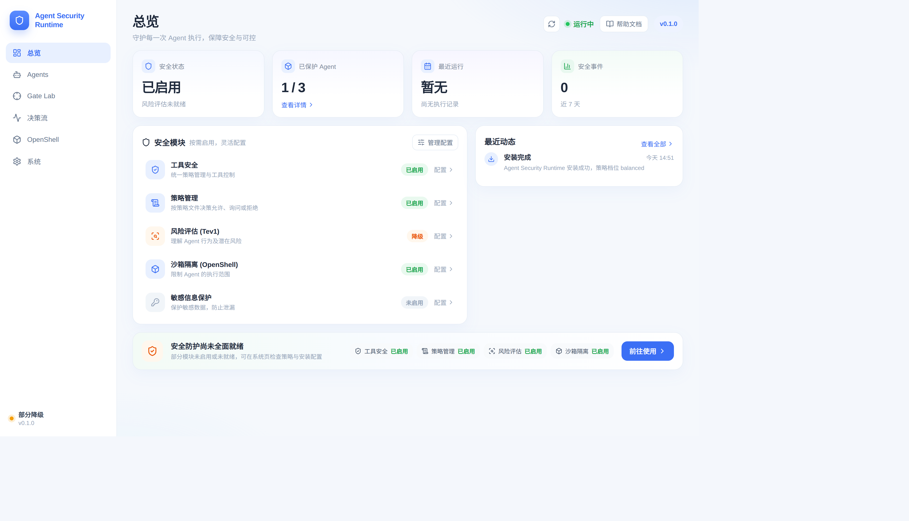
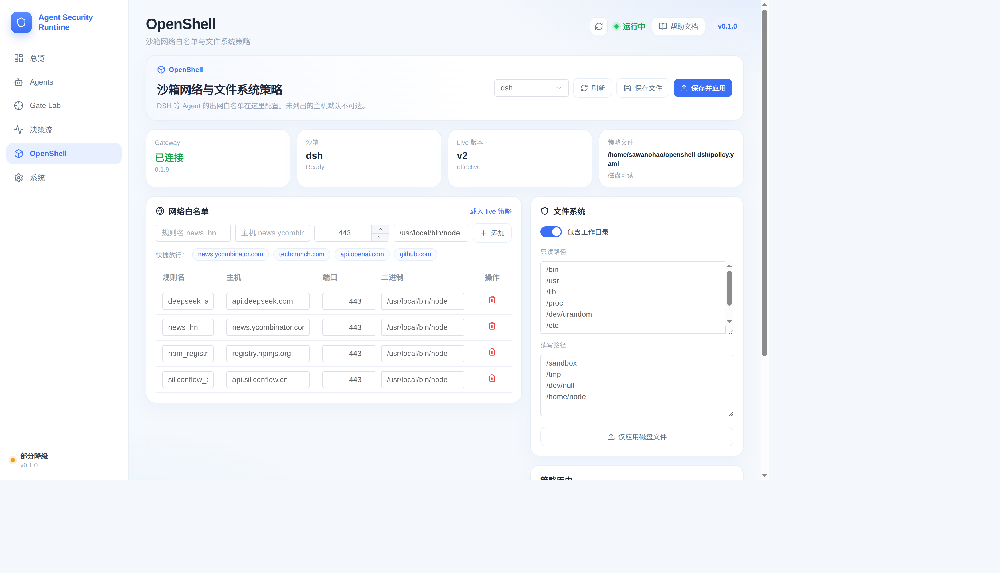
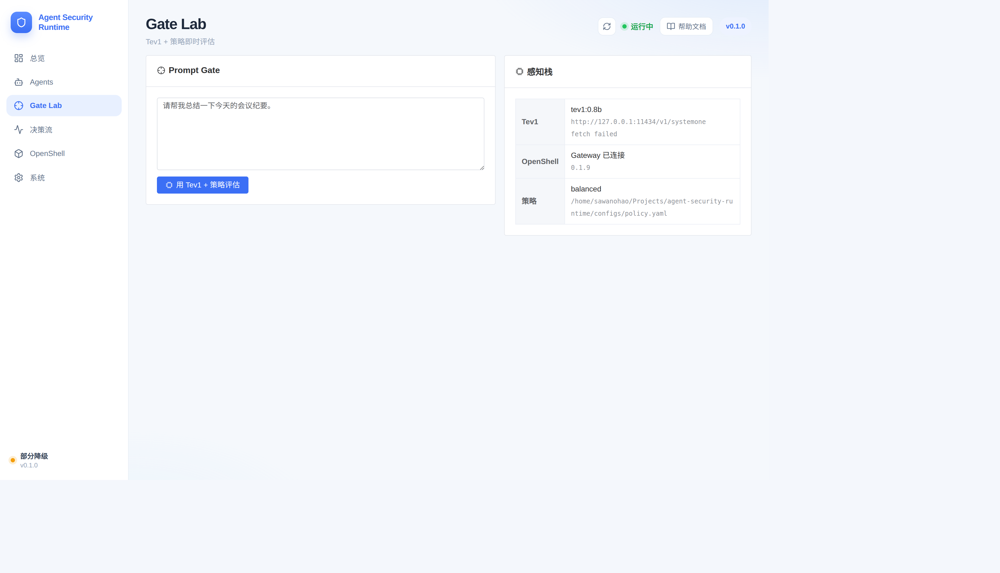
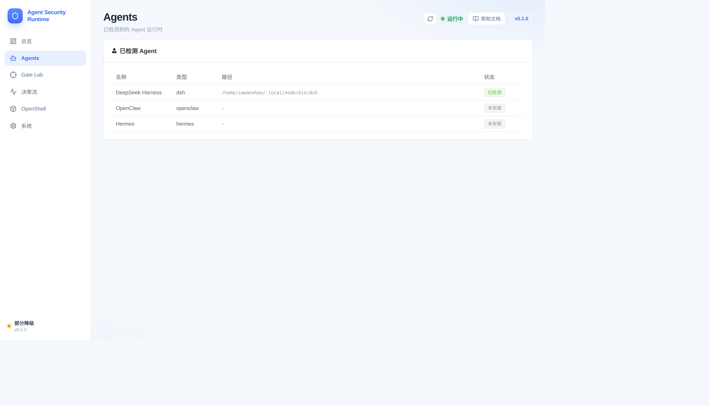
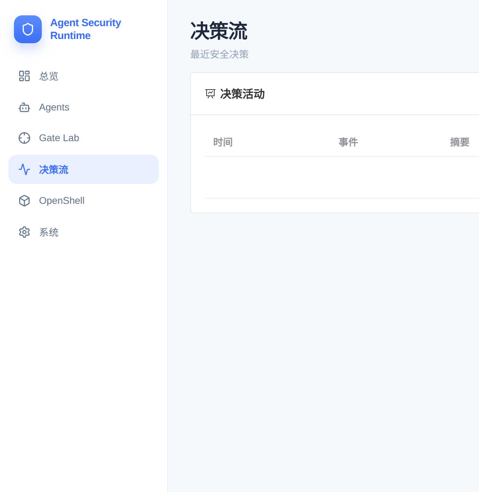
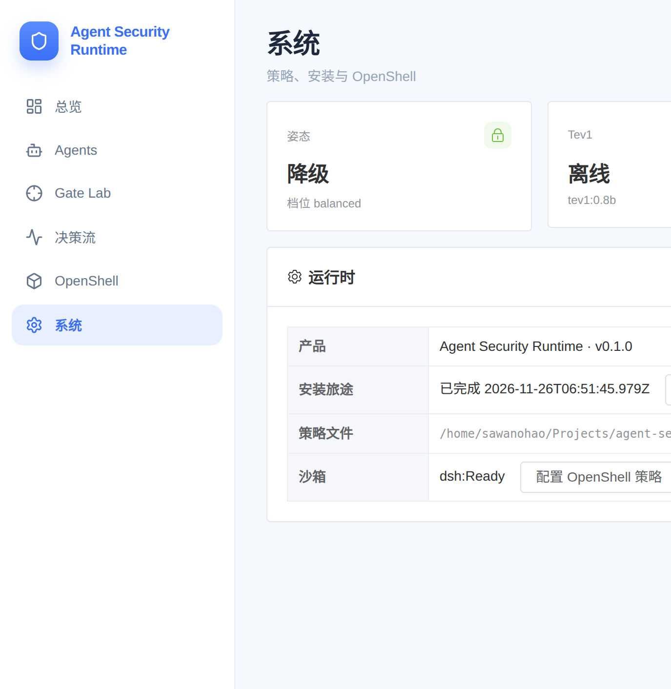

# Agent Security Runtime

Ubuntu 上的 **Agent 安全运行时（ASR）**：用统一控制面管理策略、风险评估、Skill 扫描与 OpenShell 沙箱，覆盖 DSH / OpenClaw / Hermes 等 Agent。

当前版本：`v0.1.0`

控制台地址：http://127.0.0.1:8787

---

## 目录

- [界面预览](#界面预览)
- [它解决什么问题](#它解决什么问题)
- [能力矩阵](#能力矩阵)
- [架构](#架构)
- [仓库结构](#仓库结构)
- [安装](#安装)
- [开发模式](#开发模式)
- [重启后如何拉起整套服务](#重启后如何拉起整套服务)
- [WebUI 使用说明](#webui-使用说明)
- [OpenShell 策略配置](#openshell-策略配置)
- [主要 API](#主要-api)
- [配置文件](#配置文件)
- [当前边界](#当前边界)
- [适配器](#适配器)

---

## 界面预览

### 总览

安全状态、已保护 Agent、最近运行、安全事件；下方是安全模块列表与最近动态。



### OpenShell 策略

查看 Gateway / 沙箱状态，编辑网络白名单与文件系统权限，保存并应用到 live sandbox。



### Gate Lab

对提示词做 Tev1 + 策略即时评估，并查看感知栈（Tev1 / OpenShell / 策略文件）。



### Agents

检测本机已安装的 Agent 运行时（当前已打通 DSH 检测）。



### 决策流

展示最近安全决策记录（allow / ask / deny / escalate_sandbox）。



### 系统

运行时信息、安装旅途、策略文件路径、沙箱状态，以及跳转到 OpenShell 策略页。



---

## 它解决什么问题

多用户、多 Agent 场景下，常见风险是：

1. Agent 可随意调用高危工具（shell、删文件等）
2. 提示词注入 / 恶意 Skill 把执行带偏
3. 沙箱出网范围过宽或过窄，难以运维
4. 缺少统一控制台观察“现在保护了什么”

ASR 提供统一控制面：

| 平面 | 实现 |
|------|------|
| 执行隔离 | OpenShell（沙箱状态、策略读写与热更新） |
| 决策 | YAML 策略引擎（allow / ask / deny / escalate_sandbox） |
| 感知 | Skill 扫描 + Tev1-0.8B（Ollama `/v1/systemone`） |
| 控制面 | 安装旅途 → WebUI 安全控制台 |

---

## 能力矩阵

| 能力 | 状态 | 说明 |
|------|------|------|
| 安装旅途 / 环境检测 | ✅ | 欢迎 → 环境 → 模型 → Agent → 策略档位 → 完成 |
| 安全控制台总览 | ✅ | 模块健康、Agent 数量、最近动态 |
| Gate Lab 即时评估 | ✅ | `POST /api/gate/prompt`、`/api/gate/tool` |
| Skill 扫描 | ✅ | 默认扫描 `~/.dsh` |
| OpenShell 状态探测 | ✅ | Gateway / sandbox list |
| OpenShell 策略 WebUI | ✅ | 读 live / 写文件 / 应用到沙箱 |
| DSH 安装检测 | ✅ | 适配器探测 `dsh` 与 `~/.dsh` |
| DSH 会话自动拦截 | ❌ | 尚未把 DSH 执行路径 hook 到 ASR gate |
| OpenClaw / Hermes | 预留 | 同一 `AgentAdapter` 接口，待接入 |

> 重要：打开 ASR 控制台 **不会自动** 拦截你在 DSH Web（例如 `http://127.0.0.1:3081`）里发的消息。  
> DSH 若跑在 OpenShell 沙箱内，出网由 **OpenShell 网络白名单** 控制；ASR 的 Gate Lab 目前用于人工评估与策略试验。

---

## 架构

```text
┌──────────────────────────────────────────────┐
│                 ASR WebUI (:8787)            │
│  总览 / Agents / Gate Lab / 决策流 /         │
│  OpenShell 策略 / 系统                       │
└──────────────────────┬───────────────────────┘
                       │ /api/*
┌──────────────────────▼───────────────────────┐
│              apps/server (Hono)              │
│  status / setup / gate / scan / openshell    │
└──────────────────────┬───────────────────────┘
                       │
┌──────────────────────▼───────────────────────┐
│                 @asr/core                    │
│  policy.yaml · Tev1 · skill-scan · openshell │
│  adapters(DSH/OpenClaw/Hermes) · setup       │
└───────┬───────────────────────────┬──────────┘
        │                           │
        ▼                           ▼
  Ollama Tev1                 OpenShell Gateway
  :11434                      sandbox:dsh + policy
```

---

## 仓库结构

```text
apps/
  server/          控制面 API + 托管 WebUI
  web/             安装向导 + 安全控制台（Vue + Element Plus）
packages/
  core/            策略 / Tev / Skill / OpenShell / Setup / 适配器
configs/
  policy.yaml      ASR 决策与模块开关
docs/
  images/          WebUI 截图
scripts/
  install.sh       源码安装
  build-deb.sh     打包 .deb
packaging/
  wrappers/        asr / asr-setup 启动脚本
```

---

## 安装

### 1. Debian / Ubuntu 包（推荐）

```bash
npm run build:deb
# 产物：dist/deb/agent-security-runtime_0.1.0_all.deb

sudo dpkg -i dist/deb/agent-security-runtime_0.1.0_all.deb
asr-setup    # 打开安装旅途 + 控制面
```

安装后提供：

- `asr` — 启动控制面
- `asr-setup` — 重置并打开用户旅途
- 桌面入口「Agent Security Runtime」

### 2. 源码安装脚本

```bash
bash scripts/install.sh
# 或 npm run install:asr
```

首次打开是 **安装旅途**：欢迎 → 环境检测 → 决策模型 → Agent 发现 → 策略档位 → 完成进入控制台。

状态文件：`~/.asr/state.json`（决定显示安装向导还是控制台）。

---

## 开发模式

```bash
npm install
npm run build
npm run start          # → http://127.0.0.1:8787
```

前后端分开调试：

```bash
npm run dev:server     # API :8787
npm run dev:web        # Vite :5173，代理 /api → 8787
```

构建单个包：

```bash
npm run build -w @asr/core
npm run build -w @asr/server
npm run build -w @asr/web
```

---

## 重启后如何拉起整套服务

本机常见组合：

| 组件 | 默认地址 | 作用 |
|------|----------|------|
| OpenShell Gateway | `https://127.0.0.1:17670` | 沙箱控制面 |
| DSH Web（沙箱内） | `http://127.0.0.1:3081/?token=...` | Agent UI |
| ASR | `http://127.0.0.1:8787` | 安全控制台 |

### 一键顺序（推荐）

```bash
export PATH="$HOME/.local/node/bin:/usr/bin:$PATH"

# 1) 确认 OpenShell
openshell status
openshell sandbox list
# 若沙箱不是 Ready：
# openshell sandbox start dsh

# 2) 端口转发 + 启动 DSH Web
openshell forward stop 3081 dsh 2>/dev/null || true
openshell forward start 3081 dsh -d
openshell sandbox exec --no-tty dsh -- sh -c \
  'nohup dsh web --no-open --port 3081 --host 127.0.0.1 >/tmp/dsh-web.log 2>&1 & sleep 2; cat /tmp/dsh-web.log'

# 3) 启动 ASR（使用本仓库最新构建，含 OpenShell 策略页）
cd ~/Projects/agent-security-runtime
ASR_POLICY="$PWD/configs/policy.yaml" \
ASR_STATE="$HOME/.asr/state.json" \
ASR_PORT=8787 \
  nohup node apps/server/dist/index.js >/tmp/asr-server.log 2>&1 &
```

也可以使用系统命令：

```bash
asr
```

注意：`asr` 走安装包路径 `/usr/lib/agent-security-runtime`，不一定包含你本地最新未打包的改动。开发/验证新功能时优先用仓库内 `node apps/server/dist/index.js`。

### 健康检查

```bash
openshell status
openshell forward list
curl -sf http://127.0.0.1:8787/api/health
curl -sf http://127.0.0.1:8787/api/openshell/policy?sandbox=dsh | head
```

DSH 打开时必须使用日志里打印的带 token 的 URL，例如：

```text
http://127.0.0.1:3081/?token=xxxxxxxx
```

---

## WebUI 使用说明

侧边栏页面：

| 页面 | 做什么 |
|------|--------|
| 总览 | 看保护姿态、模块健康、最近动态 |
| Agents | 看本机检测到的 Agent |
| Gate Lab | 粘贴提示词，做 Tev1 + 策略评估 |
| 决策流 | 看最近 gate / scan 产生的决策 |
| OpenShell | 编辑沙箱网络白名单与文件系统策略 |
| 系统 | 安装状态、策略路径、扫描 Skills、重新进入安装向导 |

颜色约定（决策）：

- **Allow**：绿色
- **Ask / escalate_sandbox**：橙色
- **Deny**：红色

---

## OpenShell 策略配置

当 DSH 跑在 OpenShell 沙箱 `dsh` 内时，**未放入网络白名单的主机默认不可达**。  
例如只允许 `api.deepseek.com` 时，访问 Hacker News / TechCrunch 会失败。

### 在 WebUI 中操作

1. 打开 http://127.0.0.1:8787
2. 进入 **OpenShell**
3. 选择沙箱（通常是 `dsh`）
4. 添加规则：规则名、主机、端口、二进制（DSH 一般为 `/usr/local/bin/node`）
5. 点击 **保存并应用**

也可点快捷放行：`news.ycombinator.com`、`techcrunch.com`、`api.openai.com`、`github.com`。

### 策略文件位置

ASR `configs/policy.yaml` 中：

```yaml
openshell:
  policyFile: ../openshell-dsh/policy.yaml
```

运行时会解析到本机 OpenShell 策略文件（常见为 `~/openshell-dsh/policy.yaml`）。  
WebUI 保存时会写该文件，并调用：

```bash
openshell policy set --policy <file> <sandbox> --wait
```

### 相关 API

- `GET /api/openshell/policy?sandbox=dsh`  
  返回文件策略、live 策略、历史版本、Gateway 状态
- `PUT /api/openshell/policy`  
  body: `{ sandbox, policy, apply?: boolean }`  
  写文件；`apply=true` 时热更新到沙箱
- `POST /api/openshell/policy/apply`  
  仅把磁盘策略应用到沙箱

---

## 主要 API

| 方法 | 路径 | 说明 |
|------|------|------|
| GET | `/api/health` | 健康检查 |
| GET | `/api/status` | 模块 / Agent / OpenShell / Tev / 最近决策 |
| GET | `/api/setup` | 安装旅途状态与环境检查 |
| POST | `/api/setup/advance` | 推进安装步骤 |
| POST | `/api/setup/complete` | 完成安装 |
| POST | `/api/setup/reset` | 重置安装旅途 |
| POST | `/api/gate/prompt` | 提示词门控 |
| POST | `/api/gate/tool` | 工具调用门控 |
| POST | `/api/scan/skills` | Skill 树扫描 |
| GET | `/api/openshell/policy` | 读取 OpenShell 策略快照 |
| PUT | `/api/openshell/policy` | 保存并可应用 OpenShell 策略 |
| POST | `/api/openshell/policy/apply` | 应用磁盘策略到沙箱 |

---

## 配置文件

### ASR 决策策略：`configs/policy.yaml`

关键字段：

```yaml
modules:
  toolSecurity: true
  policyEngine: true
  riskAssessment: true
  sandboxIsolation: true
  sensitiveData: false

tev:
  enabled: true
  model: tev1:0.8b
  endpoint: http://127.0.0.1:11434/v1/systemone
  blockThreshold: 0.35
  askThreshold: 0.2

tools:
  deny: [rm_rf, format_disk]
  ask: [bash, shell, exec, terminal, write_file]
  allow: ["*"]

openshell:
  requiredFor: [bash, shell, exec, terminal]
  policyFile: ../openshell-dsh/policy.yaml
```

策略档位（安装旅途中选择）会改写 Tev 阈值：

- `observe`：更宽松
- `balanced`：默认
- `strict`：更严格

### OpenShell 沙箱策略：`~/openshell-dsh/policy.yaml`

控制沙箱内：

- `network_policies`：按主机/端口/二进制放行
- `filesystem_policy`：只读 / 读写路径

---

## 当前边界

1. **ASR 不是 DSH 的透明代理**  
   DSH 对话不会自动进入 ASR 决策流；要用 Gate Lab 或后续做 hook。
2. **沙箱出网看 OpenShell 白名单**  
   DSH 搜新闻失败，优先检查 OpenShell 页的网络规则，而不是 ASR 总览。
3. **白名单绑定二进制**  
   规则通常限制为 `/usr/local/bin/node`。在沙箱里用 `curl` 测通断可能失败，但 Node/DSH 可以成功。
4. **Tev1 依赖本机 Ollama**  
   Tev 离线时，风险评估模块会显示降级；工具规则仍可工作。

---

## 适配器

第一期打穿 **DSH**（检测路径与 profile 目录）。  
OpenClaw / Hermes 预留同一 `AgentAdapter` 接口，后续可接 `beforePrompt` / `beforeToolCall`，把执行前决策接到 ASR gate。

---

## License / 维护

内部项目仓库。问题与改进建议请直接在本仓库提 issue / PR。
